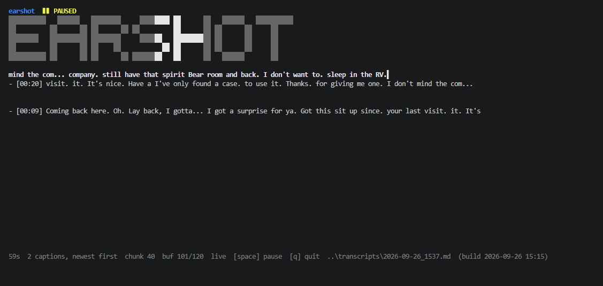

<p align="center">
  
</p>

<h1 align="center">earshot</h1>

<p align="center">
  Live captions for whatever your speakers are playing &mdash; Teams, Zoom, a webinar, a video.
  Captured from system audio, transcribed on your own GPU, never leaves your machine.
</p>

<p align="center">
  <a href="https://www.npmjs.com/package/@hell0beta/earshot" target="_blank" rel="noopener noreferrer"></a>
  <a href="https://github.com/Hell0Beta/earshot" target="_blank" rel="noopener noreferrer"></a>
  <a href="LICENSE" target="_blank" rel="noopener noreferrer"></a>
  
  
  
  
</p>

---

## ✨ About

`earshot` is a terminal captioning tool for Windows. It records your audio output
via WASAPI loopback &mdash; so it hears *exactly* what you hear, from any app, with
no per-app integration &mdash; detects speech, and transcribes it on-device with
`faster-whisper`. Speech goes in, JSON lines come out, and a Bubble Tea TUI
renders them as a live caption that streams in word by word.

No audio is uploaded. No account, no API key, no network access at runtime. If you
pull the network cable it keeps working.

```sh
npx @hell0beta/earshot
```

<div align="center">
  
</div>

---

## 🔥 Features

- 🎧 **Captures system audio, not your mic** &mdash; WASAPI loopback picks up
  Teams, Zoom, a browser tab, a game, anything routed to your output device
- 🔒 **100% local** &mdash; Whisper runs on your own GPU via CUDA; no audio ever
  leaves the machine
- ⚡ **Live line, not a slideshow** &mdash; the in-progress sentence grows word by
  word as you talk. Words are committed only once two consecutive passes agree
  on them, so the live line self-corrects instead of duplicating. Committed text
  lands in 200-character blocks. Typical lag is around **1&nbsp;s**, and the
  step **adapts to your machine** rather than falling further behind &mdash; it
  does not drift over a long session.
- 🧩 **Sentence blocks, newest first** &mdash; readable chunks with a blank line
  separating the newest from the history, wrapped to your terminal width
- 🎨 **Animated 5&times;5 splash** &mdash; a pixel-art `EARSHOT` banner with a
  travelling highlight, plus a mini banner in the header while paused
- ⏸️ **Pause without losing audio** &mdash; freeze the display, the backend keeps
  listening; unpause and the sentence picks up where it left off
- 📝 **Autosaved transcripts** &mdash; every session written to a timestamped
  `.md`, with an automatic retention cap (30 sessions by default)
- 🩺 **`earshot doctor`** &mdash; one command that tells you exactly what is
  misconfigured and how to fix it
- 🖥️ **GPU optional** &mdash; no CUDA? It falls back to CPU automatically and
  tells you so
- 🪶 **Single 5 MB binary** &mdash; no runtime for the UI layer; the Python
  backend is bootstrapped once by `earshot setup`

---

## 🚀 Quick Start

### One-off (no install)

```powershell
npx @hell0beta/earshot setup   # first time only: venv + backend deps
npx @hell0beta/earshot         # start captioning
```

### Global install

```powershell
npm install -g @hell0beta/earshot

earshot setup
earshot
```

### From source

```powershell
git clone https://github.com/Hell0Beta/earshot.git
cd earshot
npm run prepack        # builds vendor/earshot.exe
node bin/earshot.js setup
node bin/earshot.js
```

Requirements: **Windows 10/11 x64**, Python 3.9+ on `PATH` (only for the one-time
`setup`), and Node 14+ if you're using the npm wrapper.

### Upgrading from 1.x

2.0 replaced the capture engine, so several flags are **removed outright** and
one changed meaning. Most people need no action &mdash; `earshot` on its own
behaves correctly.

| 1.x flag           | In 2.0                                                            |
| ------------------ | ----------------------------------------------------------------- |
| `--window-secs`    | **removed** &rarr; use `--step-secs`, which is now a *minimum*, not a fixed cadence |
| `--context-secs`   | **removed** &mdash; there is no overlap to size anymore            |
| `--recent-chars`   | **removed** &mdash; nothing to trim against                         |
| `--chunk-secs`, `--overlap-secs` | **removed** (pre-1.3)                                  |

New in 2.0, all optional and correctly defaulted:

| Flag                    | Purpose                                                        |
| ----------------------- | -------------------------------------------------------------- |
| `--step-headroom`       | multiplier on measured pass time; raise if captions lag        |
| `--max-backlog`         | seconds of audio allowed to queue before old audio is dropped  |
| `--min-speech-secs`     | VAD gate &mdash; below this much speech, skip the model         |
| `--gate-min-buf-secs`   | only judge the gate on a buffer at least this long             |
| `--stall-passes`        | force-flush after N passes with no commit (bounds any stall)    |
| `--max-buf-secs`, `--pause-secs` | buffer cap / pause commit threshold                      |

If you keep a shortcut or script that passes `--window-secs`, it will now fail
with an unknown-flag error &mdash; delete the argument.

---

## ⌨️ Keys

| Key            | Action                                              |
| -------------- | --------------------------------------------------- |
| `space`        | pause / resume the display (backend keeps listening) |
| `q` / `ctrl+c` | quit &mdash; flushes the last sentence and saves    |
| `home`         | jump to the newest caption                          |
| `end`          | jump to the oldest                                  |
| `pgup`/`pgdn`  | scroll the history                                  |
| `↑` / `↓`      | scroll line by line                                  |

> **Quit with `q`, not the window's X.** Closing the window kills the backend
> mid-sentence and the tail of your transcript is lost.

---

## ⚙️ Options

| Flag                | Description                                              | Default              |
| ------------------- | -------------------------------------------------------- | -------------------- |
| `--model NAME`      | Whisper model (`small.en`, `base.en`, `medium.en`, `turbo`) | `small.en`         |
| `--device WHAT`     | `auto`, `cuda` or `cpu`                                  | `auto`               |
| `--compute-type T`  | CTranslate2 compute type                                 | auto per device      |
| `--step-secs N`     | *minimum* audio per cycle. The real step adapts to measured inference cost (see `--step-headroom`) | `0.3`         |
| `--step-headroom N` | multiplier on the p90 pass time used to size each cycle. Raise if captions lag on a slow machine | `1.25`         |
| `--max-backlog N`   | seconds of audio allowed to queue before the oldest is dropped. Caps caption lag | `1.5`           |
| `--max-buf-secs N`  | rolling buffer cap before the unstable tail is flushed   | `12`               |
| `--pause-secs N`    | trailing silence that counts as a pause and commits the tail | `0.2`          |
| `--min-speech-secs N` | VAD gate: skip the model when the buffer has less speech than this. Stops "Thank you for watching" over music (lower = less aggressive) | `0.10` |
| `--stall-passes N` | force-flush the tail after N passes with no commit. Bounds any stall | `6`              |
| `--beam-size N`     | beam width (`1` = greedy, cannot recover a bad early token)      | `5`                  |
| `--block-chars N`   | characters per committed sentence                                | `200`                |
| `--correct-model F` | GGUF model path; each committed sentence is polished by an LLM   | off                  |
| `--correct-threads` | threads for the correction model (`0` = auto)                    | `0`                  |
| `--chain-chars N`   | trailing characters chained into the next block          | `15`                 |
| `--out-dir DIR`     | where transcripts are written                            | `<data>/transcripts` |
| `--keep N`          | transcript sessions to retain (`0` keeps none)           | `30`                 |
| `--no-prune`        | never delete old transcripts                             | off                  |
| `--splash-style S`  | `shimmer` or `rainbow`                                   | `shimmer`            |
| `--python PATH`     | interpreter to use                                       | auto                 |
| `--backend PATH`    | backend script                                           | auto                 |
| `--model-dir DIR`   | model cache                                              | `<data>/models`      |
| `--cuda-dll-dir D`  | folder holding cuBLAS/cuDNN, prepended to `PATH`         | auto                 |

Environment: `EARSHOT_HOME` (data dir, default `%LOCALAPPDATA%\earshot`),
`EARSHOT_PYTHON`, `EARSHOT_CUDA_DLL_DIR`.

---

## 🔧 Setup, GPU and CPU

```sh
earshot setup     # create the Python venv, install backend deps
earshot doctor    # verify everything resolves
earshot           # start
```

**CPU-only machines work out of the box.** Without CUDA, earshot switches to
`int8` on the CPU and prints a note. That is slower than real-time for
`small.en`; use `--model base.en` there.

**For GPU acceleration** (optional, and the fast path) install the
[cuBLAS/cuDNN for CUDA 12](https://github.com/Purfview/whisper-standalone-win/releases/tag/libs)
pack, then either add it to your `PATH` or point earshot at it:

```powershell
$env:EARSHOT_CUDA_DLL_DIR = "D:\cuBLAS.and.cuDNN_CUDA12_win_v3"
earshot doctor    # "GPU visible to ctranslate2: 1 CUDA device(s)"
```

The first run downloads the model into `<data>/models` (~460 MB for `small.en`).
The animated splash covers the wait.

### Where files live

Models, transcripts and the fallback venv share one writable root, called the
**data dir**:

| Platform | Default                                                  |
| -------- | -------------------------------------------------------- |
| Windows  | `%LOCALAPPDATA%\earshot`                                  |
| Other    | `~/.earshot`                                              |

Set `EARSHOT_HOME` to move it &mdash; useful when `%LOCALAPPDATA%` is small, or
to keep a large model cache on a faster or roomier drive:

```powershell
[Environment]::SetEnvironmentVariable("EARSHOT_HOME", "D:\earshot", "User")
```

Run `earshot doctor` to confirm. If the variable is unset, `earshot doctor`
prints a `[warn]` line naming the folder that will be used, because a silent
~460 MB download on first run surprises people who already have the model
somewhere else.

> A shell that was already open when you set the variable keeps its old
> environment and will still resolve the default. Open a new terminal, or set
> `$env:EARSHOT_HOME` in the current one.

### Choosing a model

Scored as **word error rate against a real transcript** of known speech
(the shipped `narrated-animations` sample clips), measured on a Quadro
RTX 3000 &mdash; lower is better:

| Model | `000-testclip` | `001_genesis-4` | Note |
| ---------- | -------------- | --------------- | ----------------------------- |
| `small.en` | **9.6%** | **32.4%** | default; fastest |
| `medium.en` | &mdash; | 51.6% | worse **and** 2.8&times; slower |

Three things worth knowing, all counter-intuitive:

- **A bigger model is not a better model here.** `medium.en` scored worse than
  `small.en` on the same audio *and* took 2.8&times; as long. On continuous
  narration it filled gaps with conversational filler that was never spoken
  (`"Bye!"`, `"Thank you"`). Bigger language models have stronger priors, and
  on unbroken speech those priors invent content. Stick with `small.en`.
- **If captions are wrong, it is usually a vocabulary problem, not a timing
  one.** On the Bible-narration clip, ~20% of the reference words
  (`abel`, `adam`, `eve`, `seth`, …) are never produced by *any* configuration
  &mdash; the model simply does not know those names. No amount of tuning
  recovers a word the decoder never emits.
- **Everything here was scored against ground truth.** An earlier version of
  this table compared Whisper against Whisper, which cannot detect a
  Whisper-shaped error &mdash; it reported a 2.5&times; accuracy regression as
  an improvement. If you change the transcription path, score it against a real
  transcript too.

On CPU, prefer `base.en`; `small.en` is slower than real time there.

---

## 🧠 How it works

| Path                     | Purpose                                                                    |
| ------------------------ | -------------------------------------------------------------------------- |
| `backend/captions.py`    | WASAPI loopback &rarr; 16 kHz mono &rarr; Silero VAD &rarr; Whisper &rarr; JSON lines |
| `backend/test_assembler.py` | unit tests for the sentence assembler (no audio or GPU needed)          |
| `go/main.go`             | TUI: spawns the backend, parses events, renders captions, saves transcripts |
| `go/paths.go`            | path resolution so it runs from a checkout, a shim or `node_modules`        |
| `go/doctor.go`           | `setup` and `doctor` subcommands                                            |
| `go/splash.go`           | the pixel banner and its animations                                         |
| `go/splash_art.go`       | the banner, generated once with [`bit`](https://github.com/superstarryeyes/bit) and baked in |
| `go/transcripts.go`      | transcript retention                                                        |
| `bin/earshot.js`         | npm launcher; hands over to the native binary                              |
| `ARCHITECTURE.md`        | design notes and the decisions behind them                                  |

### The pipeline

```
speakers ──▶ WASAPI loopback ──▶ 16 kHz mono ──▶ VAD gate ──▶ Whisper (CUDA)
                                                                    │
                     transcript file ◀── TUI ◀── JSON lines ◀───────┘
```

The backend keeps one rolling audio buffer and re-decodes it on a cycle sized
from **measured** inference cost, so it consumes audio at exactly the rate your
machine can transcribe it (a fixed step silently fell behind and made lag grow
without bound). Silero VAD drops non-speech &mdash; music, room tone &mdash;
*before* it reaches the GPU, which is what stops Whisper inventing "Thank you
for watching" over a soundtrack. A word is committed only when two consecutive
passes agree on it, so duplication is structurally impossible; assembled text is
character-driven rather than time-driven, and the partially-built sentence
streams to the TUI as a live line.

Protocol, if you want to build on it: one JSON object per line on stdout
&mdash; `status`, `draft`, `final`, `error`. All logging goes to stderr, and a
`.backend.log` is written next to each transcript.

---

## 🐛 Troubleshooting

| Symptom                                     | Cause and fix                                                                     |
| ------------------------------------------- | --------------------------------------------------------------------------------- |
| Nothing appears, footer says `starting backend…` | The backend died. Read the `.backend.log` next to the transcript &mdash; it has the exact error. |
| Nothing appears, says `○ backend down`     | Backend exited. `earshot doctor` will say which check failed.                        |
| No captions but audio is playing           | Wrong capture device. `earshot doctor` &rarr; "audio capture device"; plug in headphones or pass `--device-index`. |
| Captions lag behind the audio              | The step adapts to your machine, so a steady lag means a pass is slower than the step allows. Raise `--step-headroom` (e.g. `1.6`), or lower `--max-backlog` to resync sooner. Latency grows over a session if the machine is too slow to keep up — check `.backend.log` for `backlog` readings. |
| Latency keeps growing the longer you talk  | Should not happen: the step adapts and stale audio is dropped past `--max-backlog`. If it does, report it — it means a pass is slower than the drift guard assumes. |
| Repeated or garbled words                  | Should be structurally impossible — only words two consecutive passes agree on are committed. If it happens, please report it. |
| Duplicated phrases in the live line        | Should be structurally impossible. Usually two earshot instances sharing one audio device. |
| Live line flickers / rewrites itself constantly | Block too short for the cadence — each commit is only a few passes wide | Raise `--block-chars` (200 → 400 roughly halves the churn) |
| Committed line cut off mid-word | Display cap below the backend block size | `--block-chars` must stay under the frontend's `maxLineRunes` (320) |
| Nothing appears for several seconds at start | Model load (~4s) plus the two-pass agreement dead zone. Normal, not a hang. |
| Whispers up extra words that were never said | Raise `--pause-secs` slightly, or lower `--max-buf-secs` to bound long monologues. Confidence gating (`--no-speech-threshold` and friends) is the main guard. |
| Accuracy poor on unusual vocabulary         | The model never decodes words it does not know — on the Genesis 4 clip 20.3% of reference words are absent from *every* pass (`abel`, `adam`, `eve`, `seth`, `zillah`…). No windowing change fixes this; it needs a better or domain-adapted model. |
| Quiet speaker dropped entirely             | Should not happen (VAD-only gating). Check `.backend.log` for `no speech (peak=…)`. |
| Phantom phrases during silence             | Whisper hallucinating on noise. Lower `--hallucination-silence-threshold` and `--no-speech-threshold`. |
| `CUDA failed with error no CUDA-capable device` | GPU is asleep or held. See the note below.                                  |
| Another earshot is already running         | **Only run one at a time** &mdash; two backends on one audio device will fight, and the second can wedge. |
| The GPU vanished after a restart (Code 45) | A laptop power-gating quirk, not earshot. Cold boot on AC: `shutdown /s /t 0`, hold power 15s, boot plugged in. |
| First inference seems to hang for a few seconds | Normal: the first CUDA call loads and autotunes kernels. Windows' 2-second GPU watchdog used to kill it; raise it with `TdrDelay=30` if you hit `LiveKernelEvent 141` in the event log. |
| First run took minutes and downloaded the model | The model downloads on first run (~460 MB for `small.en`, ~1.5 GB for `medium.en`). Later runs start in ~2s. If you keep models on another drive, set `EARSHOT_HOME` so the cache is not re-fetched. |
| Transcripts filling the disk               | `earshot --keep 10`, or `--no-prune` to disable entirely.                           |

`earshot doctor` is the first thing to run for any of the above.

---

## 📄 License

[MIT](LICENSE) &copy; 2026 Hell0Beta

Bundles and builds on:

- [faster-whisper](https://github.com/SYSTRAN/faster-whisper) (MIT) and
  [CTranslate2](https://github.com/OpenNMT/CTranslate2) (MIT)
- [PyAudioWPatch](https://github.com/s0d3s/PyAudioWPatch) (MIT)
- [bit](https://github.com/superstarryeyes/bit) (MIT) &mdash; the splash banner is
  rendered with its `fivebyfive` font and baked in at build time
- OpenAI Whisper model weights (MIT), downloaded on first run
